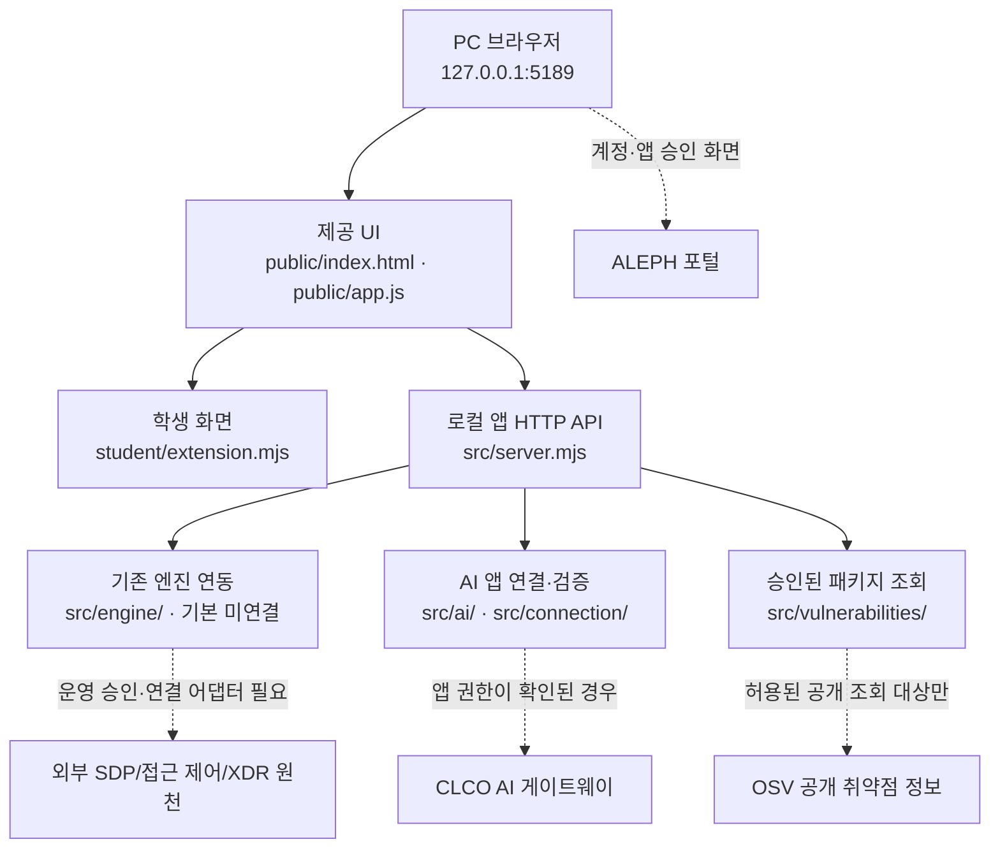

# 학생용 실행 설명서와 시스템 구성도 — olpot (케셰브 시작 틀)

> SKT ALEPH 21단계 학생 작성 문서 · 2026-10-28 · 케셰브 시작 틀 0.2.21
>
> 실제 실행한 내용, 코드를 읽어 확인한 내용, 미확인 항목을 구분한다. 이 문서는 공식 판정 결과나 실제 회사 보안 시스템 접속을 증명하지 않는다. 제공 문서는 변경하지 않으며, 승인되지 않은 보안 조치를 실행하지 않는다.

## 1. 목적과 범위

이 프로젝트의 보안 Agent **olpot**은 케셰브(KESHEV) 시작 틀을 바탕으로 **현재 사용자 본인**의 로그인·기기·세션 상태, 업무 앱 접근 판정, 최근 접속 기록과 XDR 경보를 확인하는 로컬 보안 Agent 화면이다. 확인된 기록을 바탕으로 AI 연결 상태와 사건 설명, 조치 요청의 상태를 구분해 보여 주며, 승인된 공개 패키지의 OSV 취약점 조회 결과를 표시한다. 전체 직원에 대한 관리자 콘솔이나 자동 대응 제품이 아니다.

- **학생 구현**: `student/extension.mjs`의 `createStudentView()`와 그 안의 화면 함수 8개.
- **시작 틀 제공**: 앱 서버, 요청·권한·검증 처리, 브라우저의 기본 UI, AI 연결 및 사건 원천 처리, 프로젝트 취약점 조회, 실행 도구.
- **중요한 경계**: 화면의 `connected`, ALEPH 계정 승인, AI 모델 응답 점검, SDP 업무 앱 접근 허용, 실제 보안 조치의 효과, 공식 단계 통과는 각각 다른 의미다.

## 2. 환경과 실제 작업 위치

| 항목 | 확인 내용 | 근거·상태 |
|---|---|---|
| 운영 환경 | Windows의 PowerShell | 실제 사용자 실행 기록에서 확인 |
| Git 저장소 상위 폴더 | `C:\Users\User\AppData\Local\ALEPH\Workbench\projects\olpot-security_agent` | 실제 사용자 경로에서 확인 |
| 앱 실행 폴더 | `C:\Users\User\AppData\Local\ALEPH\Workbench\projects\olpot-security_agent\on-client` | 실제 사용자 경로에서 확인 |
| 로컬 앱 주소 | `http://127.0.0.1:5189/` | README와 실행 안내에 명시, 사용자가 실행 성공 보고 |
| 시작 틀 | **0.2.21** | 0.2.14→0.2.21 업데이트가 `UPDATED`로 완료됨 |
| Node.js | 수업·검수 기준 **24.19.0**, 제공 문서의 지원 범위 **22~24** | README/제공 실행 안내. 사용 PC의 현재 `node -v`는 재확인 필요 |
| npm 종속성 | 시작 틀 README는 외부 npm 의존성이 없다고 안내 | 로컬 0.2.21 `package.json` 및 잠금 파일의 실제 상태 추가 대조 필요 |
| GitHub 저장소 | `https://github.com/junyeong-lab/olpot-security_agent` | GitHub 조회 확인 |
| 제출용 버전 기준 | 이전 GitHub 커밋에는 0.2.11이 있었고, 최신 로컬 작업 커밋 `b0fd243`은 **0.2.21** | 최종 제출 시 **업로드된 커밋**의 `package.json`으로 다시 확인 |

### 핵심 폴더 및 파일

| 상대 경로 (`on-client` 기준) | 역할 | 담당 |
|---|---|---|
| `README.md` | 시작 틀 목적·실행·제약 안내 | 제공 문서, 원문 보존 |
| `student/extension.mjs` | 학생 화면 렌더링 구현 | **학생 작성** |
| `docs/STUDENT_RUNBOOK.md` | 본 실행 설명서와 글로 작성한 구성도 | **학생 작성** |
| `docs/STUDENT_LAUNCH_GUIDE.md` | 실행·종료 안내 | 제공 문서, 원문 보존 |
| `docs/CONNECTION_TROUBLESHOOT.md` | 연결 장애와 오류 코드 안내 | 제공 문서, 원문 보존 |
| `docs/IMPLEMENTATION_CONTRACT.md` | API·학생 화면 계약 참고 | 제공 문서, 원문 보존 |
| `public/index.html`, `public/app.js`, `public/ai-connect.mjs` | 기본 브라우저 UI 및 연결 호출 | 제공 코드, 수정하지 않음 |
| `src/server.mjs` | 로컬 HTTP API와 응답 검증 | 제공 코드, 수정하지 않음 |
| `src/engine/`, `src/connection/`, `src/ai/`, `src/vulnerabilities/` | 엔진 연동·신원 확인·AI·취약점 조회 관련 처리 | 제공 코드, 수정하지 않음 |
| `tools/start-alekov.ps1` | 로컬 앱 실행 도구 | 제공 코드, 수정하지 않음 |
| `.env.example` | 비밀정보 없는 설정 항목 설명 | 제공 설정 견본, 실제 키 입력 금지 |

## 3. PowerShell 실행·종료·재실행

**실행 위치:** 파일 탐색기에서 위 `on-client` 폴더를 열고 주소창에 `powershell`을 입력해 실행한다. 다른 위치에서 명령을 실행하면 경로를 찾지 못할 수 있다.

**실행 명령** (`on-client` 폴더의 PowerShell):

```powershell
powershell -NoProfile -ExecutionPolicy Bypass -File .\tools\start-alekov.ps1
```

1. 실행 창에 케셰브가 켜졌다는 메시지와 로컬 주소가 표시되는지 확인한다.
2. 브라우저에서 `http://127.0.0.1:5189/`을 연다.
3. 기본 화면과 「보호 현황」을 확인한다. **서버 시작은 AI 연결이나 SDP 연결의 성공을 의미하지 않는다.**
4. 계정 또는 AI 연결이 필요한 경우 제공 화면의 「계정 연결 시작」, 「현재 로그인 확인」, 「AI 연결 시작」, 「승인했으며 연결 확인」 등 실제 안내를 따른다. 승인 시 현재 계정과 프로젝트가 일치하는지 확인하고 키를 수동 입력하지 않는다.

**종료:** 앱을 실행한 PowerShell 창에서 `Ctrl+C`를 눌러 종료한다. **재실행:** 같은 `on-client` 폴더에서 위 명령을 다시 실행한다. `Ctrl+C`는 브라우저를 닫는 것과 다르다.

**실행 변형 (아직 이 문서의 PC에서 직접 확인하지 않은 옵션):**

```powershell
powershell -NoProfile -ExecutionPolicy Bypass -File .\tools\start-alekov.ps1 -Demo
powershell -NoProfile -ExecutionPolicy Bypass -File .\tools\start-alekov.ps1 -Port 5190
```

`-Demo`는 예제 자료이고 실제 연결이 아니다. 포트를 변경한 경우 브라우저도 변경된 포트로 열어야 한다. 특정 인증·SDP 설정이 필요한 실행은 운영자의 정식 안내를 따르며 비밀 파일 경로·내용을 커밋하지 않는다.

**문법 검사** (`on-client` 폴더):

```powershell
npm.cmd run check
```

`npm.ps1`이 PowerShell 실행 정책에 막힐 경우 `npm.cmd`를 사용하며 시스템 실행 정책은 변경하지 않는다. `npm run check`는 `student/extension.mjs`의 **문법만** 점검한다. UI 동작이나 실제 서버 연결을 검증하지 않는다.

## 4. 시스템 구성도

다음 도식은 실행 중 관찰한 패킷 흐름의 증명이 아니라, **README·학생 함수·제공 파일의 역할을 바탕으로 작성한 논리 구성도**이다. 로컬 0.2.21 변경분의 각 내부 함수 호출은 전체 재검증 전이다.



**글로 쓴 구성 설명:** 브라우저는 `127.0.0.1:5189`에서 제공 UI를 연다. 제공 UI는 로컬 앱 서버의 `/api` 경로로 자료를 요청하고, 학생 코드 `createStudentView()`의 렌더 함수에 전달된 상태로 화면을 구성한다. 사용자 신원·접근 판정·기록은 서버의 엔진 연동 결과를 사용하며, 기본 실행에는 실제 회사 SDP가 연결되지 않는다. AI 계정 승인 과정에는 ALEPH 포털이 관여하고, 앱 전용 AI 연결은 로컬 서버의 신뢰된 연결 관리 및 CLCO 게이트웨이와 구분된다. OSV 결과는 허용된 조회 범위와 실제 설치 버전 확인을 전제로 한다. **브라우저·학생 코드는 비밀 자격을 직접 보유하거나 보안 조치를 자동 집행하지 않는다.**

## 5. 학생 작성 함수와 입력·화면 상태

`student/extension.mjs`의 외부 내보내기는 `createStudentView()`다. 확인된 화면 함수를 다음과 같이 정리한다. 함수명과 상태값은 소스의 이름을 그대로 사용한다.

| 함수 | 입력 계약(주요 항목) | 출력/오류·경계 | 확인 종류 |
|---|---|---|---|
| `renderIdentity` | `{me,devices,sessions}` | 현재 사용자, 기기 준수 상태(`compliant/noncompliant/unknown`), 세션(`active/expired/revoked/unknown`). `demo`, `disconnected`, `unknown` 구분 | 로컬 학생 코드 읽음 |
| `renderDecision` | `{status,mode,data,error,appId}` | `allow/deny/challenge/unknown`, 판정 이유·시각·원본 코드 표시. 판정 허용≠실제 앱 접속 성공 | 로컬 학생 코드 읽음 |
| `renderEvents` | `{status,mode,data,error}` | 본인 접속·XDR 기록, 시각 정렬·기록 종류/앱/접속 상태 필터·상세·근거/규칙. 미지원 조치 버튼은 비활성 | 로컬 학생 코드 읽음 |
| `renderStatus` | `{devices,sessions,notifications,diagnostics,mode}` | 등록 기기·현재 세션·알림·도움정보. 복사 전 안전 항목만 허용, 수동 다시 불러오기 | 로컬 학생 코드 읽음 |
| `renderVulnerabilities` | `{status,mode,data,error}` | `complete/partial/not_checked/not_configured/unverifiable`, 패키지 정확 버전, OSV 항목, `lockfileHash`. 미조회≠취약점 없음 | 로컬 학생 코드 읽음 |
| `renderAiConnection` | `{status,mode,data,error,checkedAt,explanationAccepted}` | `transportChecked`, `modelCount`, `audienceAuthorization(test/verified)` 검증 후 표시. 연결 점검≠사건 설명 | 로컬 학생 코드 601~800줄 읽음 |
| `renderExplanation` | `{event,explanation,checkedAt}` | 사건 ID·요약·근거 ID와 원문·규칙·`unknown` 상태·조치 제안. 근거 일치·미집행 상태 검증, 설명 실패와 원천 기록 분리 | 로컬 일부 + GitHub 저장소 공개본 확인; **로컬 후반부 대조 필요** |
| `renderAction` | `{status,event,actionId,target,receipt,observation,message,confirmationExpiresAt,error}` | `idle/prepared/executing/pending/succeeded/denied/failed/unknown/expired/error` 구분. 서버 접수(ACK)≠효과 확인, 사용자 확인·원천 관측 필요 | GitHub 저장소 공개본 확인; **로컬 후반부 대조 필요** |

### 데이터와 권한의 경계

- `student/extension.mjs`는 **전달된 상태를 표시**한다. 자료 조회, 보안 정책 판정, AI 자격 발급, 실제 조치 집행·결과 조회는 제공 서버와 연동 시스템의 책임이다.
- 학생 DOM은 `document.createElement()`와 `textContent`를 사용한다. 기록 상세 토글, 필터, 도움정보 복사 등은 이용자 조작에 의해 동작한다.
- 표시 상태 `loading/error/ok/idle`, `demo/connected/disconnected/unknown`을 혼동하지 않는다. `unknown`, `partial`, `unverifiable` 또는 오류는 정상·안전·조치 성공으로 간주하지 않는다.
- AI 설명은 근거와 규칙에 대한 **참고용 설명**이다. AI가 제안한 조치는 자동 실행되지 않으며, 실제 집행과 효과 확인은 제공 서버의 별도 절차를 거친다.

## 6. 오류별 확인·복구 절차

| 상황/코드 | 먼저 확인할 것 | 안전한 다음 조치 |
|---|---|---|
| 앱 시작 실패·포트 충돌 | PowerShell 현재 폴더가 `on-client`인지, 로컬 포트 5189를 다른 프로세스가 사용하는지 | 임의로 프로세스를 종료하지 말고 제공 실행 도구의 `-Port 5190`을 검토 |
| `npm.ps1` 실행 제한 | PowerShell 실행 정책에 따라 npm 스크립트가 차단됨 | 정책 변경 없이 `npm.cmd run check` 사용 |
| `NATIVE_HOST_DISABLED` 등 계정 연결 문제 | 최신 시작 틀 0.2.21 적용, 계정·프로젝트·현재 로그인 일치 확인 | 정식 계정 연결 절차를 따르고, 반복되면 제공 도움정보를 담당자에게 전달 |
| `ALEKOV_CONNECT_CONTEXT_CHANGED` | 연결 시작 전후 계정·프로젝트·세션 연속성 | 성공으로 간주하지 않음. 공식 절차에 따라 현재 계정으로 새 연결, 반복 시 운영자 확인 |
| `ALEKOV_CONNECT_OUTCOME_UNKNOWN`, `ALEKOV_CONNECT_STORAGE_UNVERIFIED` | 포털 승인 후 앱 연결 상태 및 제공 「연결 도움정보」 | 자동 재승인·키 입력·우회 금지. 운영자에게 연결/저장 상태 확인 요청 |
| `ON_AI_PROVISIONING_PENDING`, `ON_AI_MODEL_LIST_EMPTY` | 계정 연결·앱 전용 권한·모델 허용 상태 | 담당자에게 권한·설정 확인 요청. 연결 점검을 성공으로 표시하지 않음 |
| `NETWORK_ERROR`, `TIMEOUT` | 앱 실행 상태, 네트워크 및 현재 오류 코드 | 제공 화면에서 사용자 판단으로 재점검. 자동 재시도 금지 |
| `ENGINE_NOT_CONNECTED`, `ENGINE_RESULT_UNVERIFIED`, `CONTRACT_MISMATCH` | 실제 SDP 어댑터 연결 여부, 원천 응답/계약 | 예제나 빈 목록으로 위장하지 않고 미연결·확인 불가로 표시, 담당자 확인 |
| OSV `partial`, `not_checked`, `not_configured`, `unverifiable` | 공개 조회 허용 목록, 실제 설치 버전·잠금 파일 대조 | 확인된 결과만 표시하고 미확인을 취약점 없음으로 바꾸지 않음 |
| 조치 `pending`/`unknown` | 요청 ID·영수증·관측 시각·`effectApplied` | ACK만으로 성공 처리 금지. 중복 집행하지 말고 같은 요청의 원천 결과 확인 |

오류 코드와 버튼의 최종 동작은 현재 시작 틀의 `docs/CONNECTION_TROUBLESHOOT.md` 및 제공 UI가 우선한다. 비밀 키, 토큰, 개인 인증서, 실제 설정 파일을 채팅·README·Git에 출력하지 않는다.

## 7. 확인 결과와 미확인 범위

| 항목 | 결과·근거 | 분류 |
|---|---|---|
| 0.2.14→0.2.21 업데이트 | `DRY_RUN_READY` 확인 후 `UPDATED`·`ok:true` 응답, 백업 ID 발급 | **사용자 실행 결과 확인** |
| PC 전체 프로젝트 백업 | 102개 원본/백업, SHA-256 불일치 0개(10월 26일 백업 당시) | **사용자 실행 결과 확인** |
| 앱 실행 | 0.2.21 실행 명령 뒤 정상 실행되었다고 사용자 보고 | **사용자 실행 보고** |
| ALEPH 계정·AI 앱 승인 | 0.2.21 적용 후 AI 연결까지 마무리했다고 사용자 보고 | **사용자 실행 보고**; 세부 API 응답·모델 호출 미확인 |
| 학생 코드 문법 검사 | 0.2.21에서 `npm.cmd ... run check` 통과 | **사용자 실행 결과 확인**; 문법 검사만 통과, 기능 검증은 별도 |
| 학생 화면 함수 8개 | 로컬의 주요 구간을 사용자 출력으로 확인, 전체 8개 함수는 GitHub 소스에서 확인 | **정적 코드 확인**; 실제 기능 동작 검증은 별도 |
| AI 모델 응답 점검(`verified`), 실제 사건 설명 | 연결 승인만으로 해당 기능 완료를 뜻하지 않음 | **미확인** |
| 실제 SDP 회사 서버, 실제 업무 앱 접근 제어, 실제 보안 조치 효과 | 필요한 운영 설정·인증/관측이 입증되지 않음 | **미확인/기본 미연결** |
| 실제 OSV 외부 조회 결과 | 학생 화면 구현만 확인, 실제 성공 응답 미제공 | **미확인** |
| `-Demo`, `-Port 5190`, 종료·재실행의 현재 0.2.21 직접 재현 | 공식 문서상 안내는 존재, 이 버전에서 사용자 재현 기록 없음 | **미확인** |
| 최신 제공 코드와 제출 커밋 | 이전 GitHub에는 0.2.11이 있었고 로컬 커밋 `b0fd243`에 0.2.21이 반영됨 | **GitHub 업로드 및 최종 커밋의 반영 여부는 별도 확인** |
| 21단계 공식 제출 및 판정 | 문서 작성 및 로컬 Git 커밋 생성됨. **포털 제출·판정은 미실행** | **미제출** |

## 8. 제공 화면·API 계약 대조 및 증빙 수준

### 8.1 학생 화면과 제공 화면의 책임 구분

| 화면·버튼 | 구현 주체 | 실제 의미·한계 |
|---|---|---|
| 「보호 현황」, 「업무 앱」, 「보안 기록」 | 제공 `public/index.html`, `public/app.js` | 화면 이동과 API 호출은 제공 UI가 담당; 학생 렌더 함수는 받은 상태를 표시 |
| 「계정 연결 시작」, 「현재 로그인 확인」 | 제공 native 계정 연결 | 포털 계정 확인이며 SDP 원천 사용자 연결을 보증하지 않음 |
| 「AI 연결 시작」, 「승인했으며 연결 확인」 | 제공 AI 앱 연결 기능 | 앱 연결 승인과 자격 보관 결과 확인; 모델 점검과 사건 설명은 별도 |
| 「현재 API 연결 점검」 | 제공 AI 연결 점검 기능 | `transportChecked`, `audienceAuthorization`, 모델 수와 시각을 확인; 실제 사건 설명은 아님 |
| 「다시 불러오기」, 「도움정보 불러오기」 | 제공 UI | 사용자가 명시적으로 누를 때만 조회하며 자동 재시도하지 않음 |
| 「도움정보 복사」 | 학생 `renderStatus` | 허용된 비밀 없는 필드만 복사; 사용자 클릭 필요 |
| 사건 상세 버튼·기록 필터 | 학생 `renderEvents` | 제공된 본인 범위의 기록만 로컬 필터링; 새로운 서버 요청을 만들지 않음 |
| 보안 조치 준비·확인·원천 결과 조회 | 제공 화면·제공 서버 | 사람 확인·연동 원천 확인이 필요; 학생 `renderAction`은 상태 표시만 담당 |

위 버튼 이름은 기존 제공 코드 및 사용자 화면 기록에 근거한 표현이며, **0.2.21의 실제 화면 문구와 최종 대조는 사용자 직접 확인 항목**이다. 학생 문서는 제공 HTML·서버의 UI 계약을 변경하지 않는다.

### 8.2 주요 로컬 API와 데이터 흐름

- `GET /api/me`, `/api/devices`, `/api/sessions`, `/api/apps`: 제공 서버가 본인 범위의 상태를 조회하고 학생 렌더 함수가 표시한다.
- `POST /api/access`: `{appId}`를 전달하여 `allow/deny/challenge/unknown` 판정을 받는다. `allow`는 업무 앱의 실제 접속 완료를 의미하지 않는다.
- `GET /api/events`: 현재 사용자 범위의 접속·XDR 기록을 반환한다. `renderEvents`는 원본 근거·규칙과 사건 당시 `unknown` 상태를 별도로 표시한다.
- `POST /api/ai/connect/start`, `finish`, `status`, `cancel`: 제공 서버의 앱 전용 연결 프로토콜이며 학생 렌더 함수가 직접 자격·비밀값을 다루지 않는다.
- `POST /api/ai/check`, `POST /api/ai/explain`: 모델 연결 점검과 특정 사건에 대한 AI 설명 요청은 별개다. AI 설명은 사건 원천의 근거·규칙 ID와 일치해야 하며 조치가 실행됐다고 주장해서는 안 된다.
- 취약점 조회 및 조치 API는 제공 서버에서 검증·실행한다. 학생 화면은 결과를 표시하며, 미확인 결과를 정상으로 바꾸지 않는다.

위 경로는 기존 시작 틀 `docs/IMPLEMENTATION_CONTRACT.md` 및 소스에 기재된 계약을 설명한다. 최신 0.2.21의 전체 서버 라우트 계약과 실행 결과는 별도 점검 범위다.

### 8.3 실제 확인 결과와 미확인 범위의 구분

- **실제 PC에서 확인:** 0.2.21 업데이트 도구 `DRY_RUN_READY` → `UPDATED`, 앱 실행, Git 로컬 커밋, `npm.cmd ... run check` 문법 검사 통과.
- **사용자 보고:** ALEPH 계정·앱 AI 연결 완료. 이는 실제 모델 응답 점검(`verified`) 또는 사건 설명 호출 성공과 구분한다.
- **코드 읽기로 확인:** 학생 화면 8개 함수와 주요 데이터 구조, 상태별 문구, 미지원 조치의 비활성화 처리.
- **미확인:** 0.2.21에서 처음부터 종료까지 독립 재현, 실제 회사 SDP 연결과 접근 통제, 실제 OSV 공개 조회 성공, AI 사건 설명 성공, 실제 보안 조치 효과 관측, 21단계 공식 AI 판정.

## 9. 인수인계·제출 전 점검

- [ ] 최신 로컬 `package.json`, `.env.example`, README, 시작 스크립트를 이 문서의 명령·버전과 대조한다.
- [ ] 학생 `extension.mjs` 후반부는 GitHub 커밋에서 정적 확인했다. 로컬 0.2.21과의 일치 여부는 `git status` 및 SHA 비교로 별도 확인한다.
- [ ] 새 PowerShell에서 시작→브라우저 확인→종료(`Ctrl+C`)→재실행을 **직접** 해 본 뒤 증거를 기록한다.
- [ ] 제공 화면의 실제 버튼 이름과 상태 표시가 이 문서와 같은지 확인한다.
- [ ] 변경 파일을 확인해 제공 코드 덮어쓰기·비밀 설정값 유입이 없는지 점검한다.
- [x] `docs/STUDENT_RUNBOOK.md`를 학생 문서로 저장했다. 제공 문서 원문은 지우지 않는다.
- [ ] 기존 GitHub 커밋에 있던 21단계 문서와 로컬 최신 문서를 보존·통합하고, 0.2.21 제공 코드와 함께 **최종 제출 커밋**으로 반영한다.
- [ ] 공식 21단계 화면에서 저장소 URL과 **실제 40자리 커밋 SHA**를 입력한다. 비공개 저장소인 경우에만 공식 원문 전달 절차를 추가 확인한다.
- [ ] 포털의 AI 판정 설명과 최종 통과 여부를 **실제로** 확인한다. 작성된 문서나 원문 전달만으로 통과를 주장하지 않는다.

### 제출 참고

Git 상위 폴더는 `on-client`의 **한 단계 위**이다. 21·22단계는 워크벤치의 기존 「포털 제출 준비」가 아니라, 공식 21단계 화면에 저장소 주소 및 커밋 SHA를 입력한다. 저장소가 공개인 경우 GitHub에 제출 커밋이 실제 올라와 있는지 확인하고, 비공개 저장소의 원문 묶음은 공식 화면의 안내된 도구만 사용한다. **본 문서가 포함된 로컬 작업 커밋은 생성됐지만 GitHub 업로드와 공식 21단계 제출·판정은 별도로 확인해야 한다.**

---

### 출처 구분 메모

- 로컬 사용자 제공 증거: README 0.2.21, 업데이트 `DRY_RUN_READY`/`UPDATED`, `student/extension.mjs` 1~800줄 일부, 앱 실행·AI 연결 보고.
- GitHub 읽기 확인: `junyeong-lab/olpot-security_agent` 기본 브랜치의 학생 화면 함수 및 제공 문서. 이 브랜치의 시작 틀은 당시 **0.2.11**이었으므로 최신 PC 제공 코드의 대용 자료로 사용하지 않는다.
- 과제 조건: 사용자가 전달한 공식 21단계 「학생용 실행 설명서와 시스템 구성도」 안내. 공식 제출·판정은 아직 수행하지 않았다.
